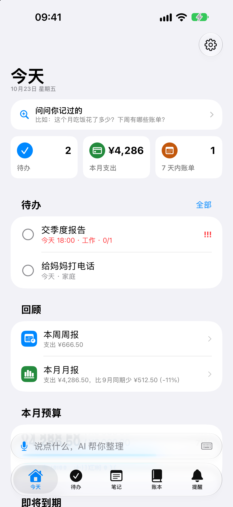
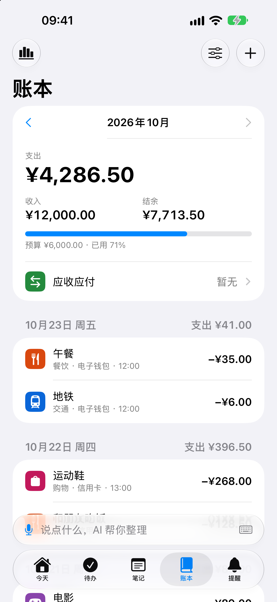
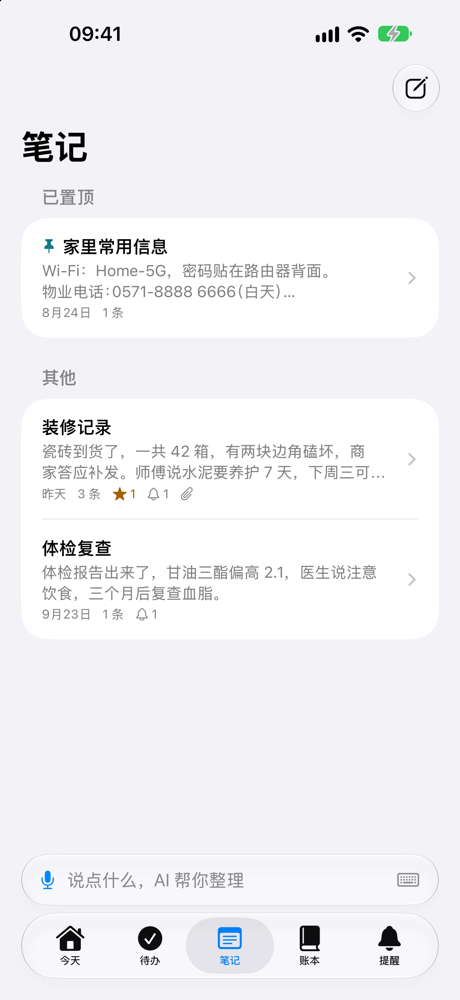
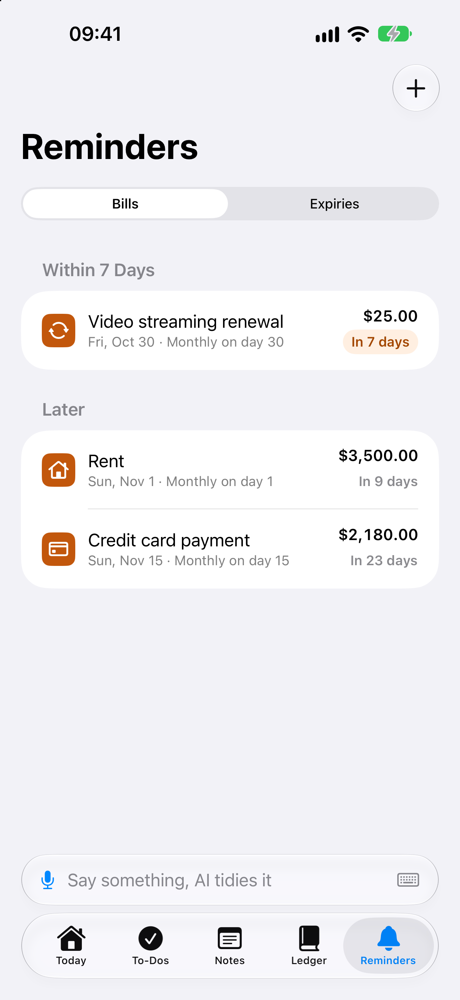

# 随口记 Ramble

想到什么，说一句就记下。随口记把你随口说的话整理成待办、账目、账单和到期提醒、笔记。语音识别和 AI 整理都可以完全在 iPhone 上完成。

Say it once and it's kept. Ramble turns what you say into to-dos, ledger entries, bill and expiry reminders, and notes. Speech recognition and AI tidying can both run entirely on your iPhone.

<p>




</p>

完全免费、没有内购和广告，以 MIT 许可开源。Free, no in-app purchases or ads, open source under the MIT License.

- 隐私政策 Privacy Policy：<https://hellomyworkid-tech.github.io/ramble/privacy.html>
- 联系 Contact：hellolink@icloud.com

## 功能 Features

- **一句话，自动整理**：「明天下午三点交房租 3200，中午吃饭花了 35」会变成一条待办、一个账单提醒和一笔支出，确认后才保存
- **待办**：截止时间、提醒、重复、子任务、优先级
- **账本**：多账户、多币种（自动汇率）、分类、预算、统计图表、应收应付，导入微信支付、支付宝和其他 App 的 CSV
- **账单和到期**：信用卡、房租、订阅、证件、保险、合同，到期前提醒
- **笔记**：按时间追加的记录，AI 理顺语句、标重点、给某句话设提醒，照片和文件里的字也能搜索
- **AI 读文件**：体检报告、合同、保修卡、发票，在手机上识别文字后总结要点，并建议复查、续期等提醒
- **问一问、周报月报**：「这个月吃饭花了多少」，数字都在手机上算
- **其他**：iCloud 同步（用户自己的私有数据库）、小组件、Siri 和快捷指令、面容 ID 应用锁、完整备份和恢复、简体中文和英文界面

## AI 和隐私 AI and privacy

开发者没有任何服务器。整理用哪个模型由用户选：

| | 在哪运行 | 说明 |
|---|---|---|
| Apple Intelligence | iPhone | 系统自带，支持的机型才有 |
| 通义千问 Qwen3 4B / 1.7B | iPhone（MLX） | 从 Hugging Face 下载的开源模型（Apache 2.0），需要 iOS 27 |
| Claude、ChatGPT、Gemini、任何兼容 OpenAI 的接口 | 云端 | 用户自己的 API Key，文字从手机直接发给服务商，第一次使用前征得同意 |

语音识别用 iPhone 自带的 SpeechAnalyzer，或下载的 Qwen3-ASR 0.6B / 1.7B（MLX，在手机上运行）。

The developer runs no servers. Tidying uses Apple Intelligence, a downloaded open-source model running on the iPhone with MLX, or a cloud model with the user's own API key, sent straight from the phone to the provider after consent.

## 编译 Building

需要 Xcode 27.1 或更新版本（iOS 27.1 SDK），App 最低支持 iOS 26，只支持 iPhone。依赖用 Swift Package Manager，打开工程时会自动下载。

Requires Xcode 27.1 or later. The app targets iOS 26+, iPhone only. Swift packages resolve when the project opens.

1. 打开 `Ramble.xcodeproj`。
2. 在三个 target（Ramble、RambleWidgets、RambleTests）的 Signing & Capabilities 里把 Team 换成你自己的，并把这些标识换成你自己的（它们只能属于一个开发者账号）：
   - Bundle ID：`com.zengji.suikouji`、`com.zengji.suikouji.widgets`、`com.zengji.suikouji.tests`
   - App Group：`group.com.zengji.suikouji`（`Config/*.entitlements`、`RambleShared/WidgetShared.swift`）
   - iCloud 容器：`iCloud.com.zengji.suikouji`（`Config/Ramble.entitlements`、`Ramble/Services/CloudSync.swift`）
3. 在真机上运行。本机开源模型需要 iPhone 的 GPU，在模拟器里不能用。日常使用建议装 Release 版：Debug 版的 MLX 慢很多。

```bash
xcodebuild -project Ramble.xcodeproj -scheme Ramble -configuration Release -destination 'generic/platform=iOS' build
```

iCloud 同步：开发版用 CloudKit 的 Development 环境。要发布时，先用 Debug 版带启动参数 `-initializeCloudKitSchema` 运行一次，把所有记录类型建到 Development 环境，再在 [CloudKit Console](https://icloud.developer.apple.com) 部署到 Production。

## 测试 Tests

```bash
xcodebuild -project Ramble.xcodeproj -scheme Ramble -destination 'platform=iOS Simulator,name=iPhone 18 Pro' -testLanguage zh-Hans -testRegion zh_CN test
```

测试默认按简体中文环境写（解析的是中文口语）。语音模型的端到端测试需要在真机上、先下载好模型才会运行。

Debug 版的启动参数：`-sampleData`（载入示例数据）、`-startTab ledger`（打开某个标签页）、`-openNote 装修记录`、`-openAsk`、`-inMemoryStore`。

## 目录 Layout

| 目录 | 内容 |
|---|---|
| `Ramble/App` | 入口、根视图、路由、Siri 和快捷指令、应用锁 |
| `Ramble/AI` | 整理（规则 + 模型）、提示词、Apple 模型和开源模型、云端客户端、问一问 |
| `Ramble/Speech` | 录音、SpeechAnalyzer、Qwen3-ASR |
| `Ramble/Models` | SwiftData 模型 |
| `Ramble/Services` | 查询、报告、同步、备份、CSV、汇率、小组件数据 |
| `Ramble/Features` | 各个页面 |
| `RambleWidgets`、`RambleShared` | 小组件，以及 App 和小组件共用的代码 |
| `Vendor` | 打了补丁的 mlx-swift-lm 和 mlx-audio-swift（补丁见各自的 `RAMBLE-PATCHES.md`） |
| `docs` | 需求和设计说明（中文）、App Store 资料、截图 |
| `website` | 隐私政策和支持页的生成脚本（生成的网页发布在 `gh-pages` 分支） |
| `scripts` | `make_licenses.py`：生成 App 里的「开源许可」页 |

## 许可 License

随口记以 [MIT 许可](LICENSE) 发布。App 里用到的第三方开源软件及其许可见「设置 › 关于 › 开源许可」，或 [`Ramble/Resources/Legal/licenses.md`](Ramble/Resources/Legal/licenses.md)。下载的模型（Qwen3、Qwen3-ASR）不随 App 分发，采用 Apache 2.0 许可。

Ramble is released under the [MIT License](LICENSE). Third-party licenses are listed in the app (Settings › About › Open-Source Licenses) and in [`Ramble/Resources/Legal/licenses.md`](Ramble/Resources/Legal/licenses.md).

欢迎提 issue 和 pull request。Issues and pull requests are welcome.
